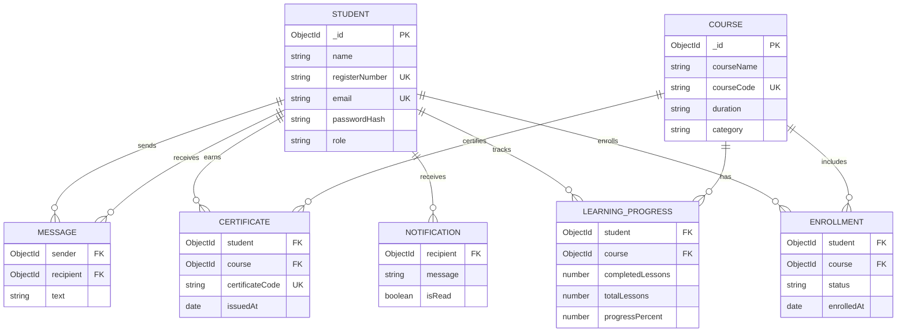

# Database Schema

MongoDB stores application records in the collections below. Mongoose references use the existing `Student` model as the single account collection; there is no parallel `User` model. Course `duration` remains a display string (for example, `8 Weeks`) to match the current UI.

## Collections

- `students`: name, unique normalized email, optional unique register number, phone, department, year (`I`, `II`, or `III`), hidden bcrypt `passwordHash`, role (`student` or `admin`), and timestamps. Student-specific fields are required for student accounts; administrator accounts are created by the backend script.
- `courses`: unique course code, name, instructor, duration string, level, category, status, overview, resource URLs, materials, and timestamps. Required values are name, code, duration, and category.
- `enrollments`: student/course references, status (`active`, `completed`, or `withdrawn`), enrollment date, and timestamps. Unique compound index on `{ student: 1, course: 1 }`; withdrawn records are reactivated instead of duplicated.
- `learningprogress`: student/course references, completed and total lesson counts, calculated percentage, and timestamps. Unique compound index on `{ student: 1, course: 1 }`.
- `notifications`: recipient reference, message (maximum 500 characters), read state, and timestamps. Index on `{ recipient: 1, createdAt: -1 }`.
- `messages`: sender and recipient references, text (maximum 2,000 characters), and timestamps. Index on `{ sender: 1, recipient: 1, createdAt: -1 }`.
- `certificates`: student/course references, unique certificate code, issue date, and timestamps. Unique compound index on `{ student: 1, course: 1 }`; generated once when a student completes an enrolled course.

MongoDB creates `_id` values for every document. Account and course password/role authorization is checked against the current database record on authenticated HTTP and WebSocket requests.